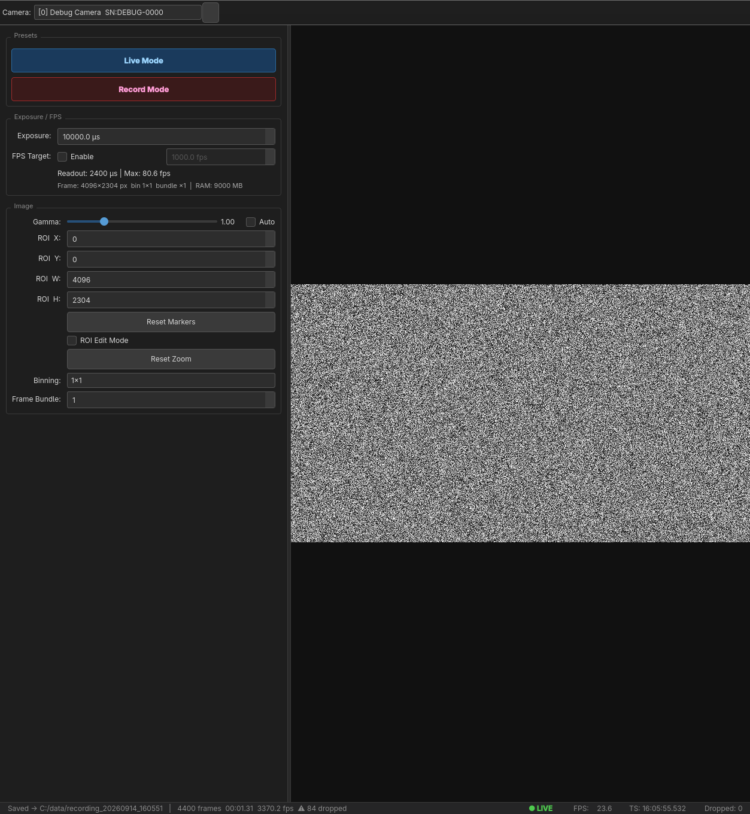
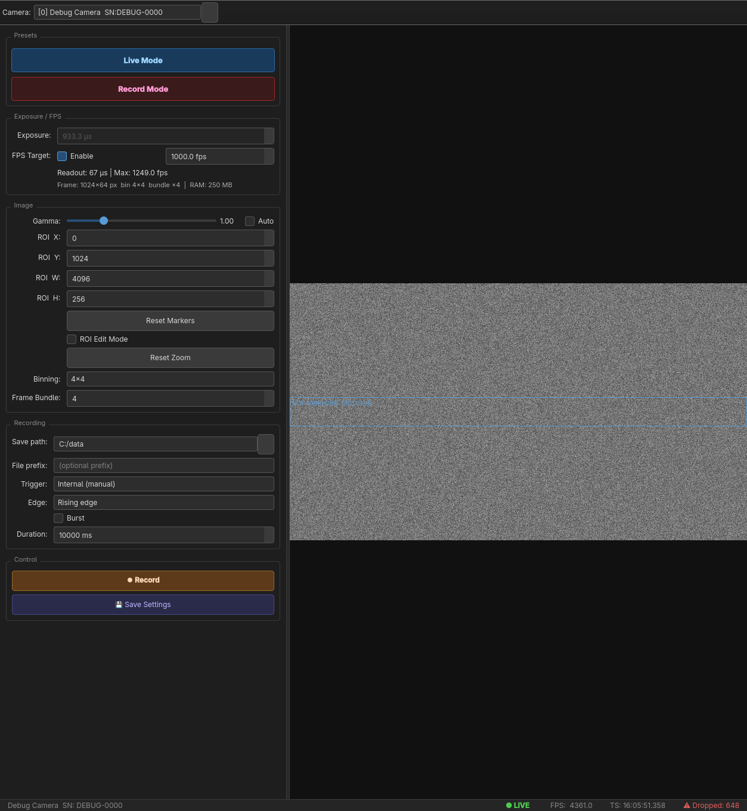
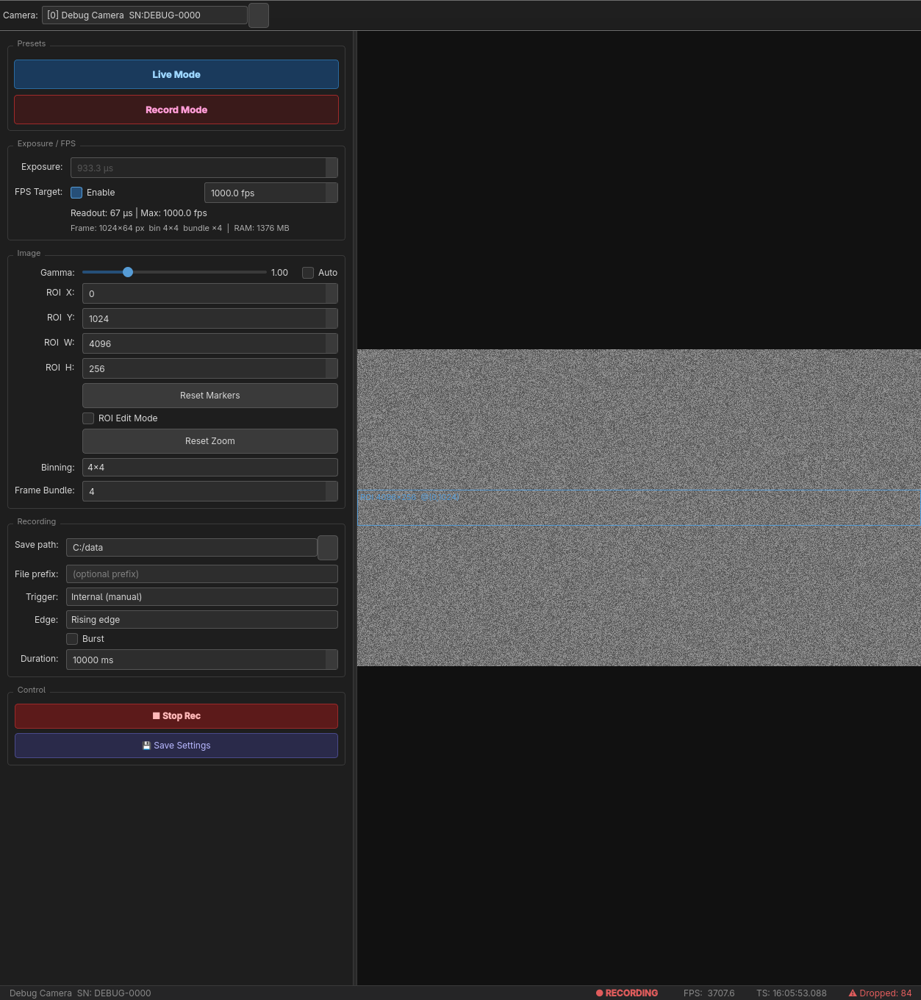
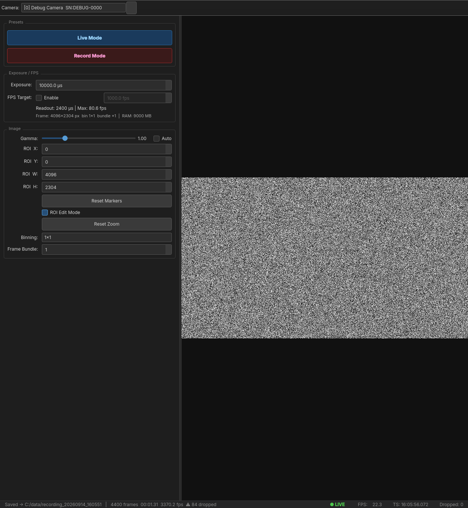

# ORCA-Quest C15550-20UP Camera GUI

Desktop application for live preview and high-speed recording from the Hamamatsu ORCA-Quest qCMOS camera via CoaXPress on Windows.

---

## Hardware Requirements

| Component | Requirement |
|---|---|
| Camera | Hamamatsu C15550-20UP (ORCA-Quest) |
| Interface | CoaXPress Quad CXP-6 frame grabber (PCIe) |
| OS | Windows 10 or Windows 11 (64-bit) |
| RAM | ≥ 16 GB recommended (recording buffer uses up to ~4 GB) |
| Storage | **NVMe SSD required** for recording at 1000+ fps (needs ~2 GB/s sustained write) |

> USB 3.1 mode is limited to ~17 fps and **cannot** reach 1000+ fps. CoaXPress is mandatory.

---

## Driver & SDK Installation

### 1. DCAM-SDK4 (mandatory)

Download from [dcam-api.com](https://dcam-api.com/dcam-sdk-login-2/) — free, requires registration.

The installer places `dcamapi.dll` on the system PATH. This DLL is the only runtime dependency needed by this application.

Alternatively, `dcamapi.dll` is bundled with Hamamatsu's own software (HoKaWo, HiPic) if you have either installed.

### 2. CoaXPress Frame Grabber Driver

Install the driver provided with your specific frame grabber card. Verified compatible brands:
- Active Silicon
- Euresys
- BitFlow

After installing the frame grabber driver, connect the camera with all four CXP-6 cables (Quad CXP-6 = 4× coaxial cables). The DCAM-API will detect the camera automatically once both drivers are installed.

### 3. Verify Installation

Open **HoKaWo** (included with DCAM-SDK4) and confirm the camera appears and shows a live image before running this application.

---

## Python Setup

```bash
# Python 3.10 or newer recommended
pip install PyQt6 numpy
```

No other dependencies — the output format is raw binary (no HDF5/TIFF libraries needed).

---

## Running the Application

```bash
cd DCAM
python main.py
```

On first launch the app connects to the camera automatically. If the camera is not found, a dialog explains what is missing and the app remains open.

---

## Screenshots

### Live Mode — full sensor preview (4096 × 2304)



Live mode uses the full sensor at moderate frame rate. The settings panel on the left shows exposure, ROI, gamma, binning, and frame bundle controls. The status bar at the bottom shows `● LIVE`, measured FPS, the hardware timestamp of the last frame, and the dropped-frame counter.

---

### Record Mode preset — 256-row ROI at 1000 fps



Clicking **Record Mode** loads `config/record_mode.json`: the ROI shrinks to 4096 × 256 centred vertically, FPS target is set to 1000, and the Recording section expands to show save path, trigger source, trigger edge, and duration controls. The blue stripe visible in the live view is the active ROI.

---

### Recording active



While recording, the **⏺ Record** button is replaced by **■ Stop Rec** and the status bar switches to `● RECORDING` (red). Frames are streamed from the camera into the RAM ring buffer while the writer thread drains it to disk in parallel. The live view continues updating at 60 Hz.

---

### ROI Edit Mode



Checking **ROI Edit Mode** in the Image section lets you drag a new ROI directly on the live view. While active the cursor changes and the dragged rectangle is previewed in blue. On release the ROI spinboxes in the panel update and the camera restarts with the new region.

---

## GUI Overview

```
┌──────────────────────┬─────────────────────────────────────────┐
│   Settings Panel     │                                         │
│   (left, fixed)      │         Live View                       │
│                      │   (scales to window, keeps aspect)      │
│  [Live Mode]         │                                         │
│  [Record Mode]       │   ROI overlay drawn in blue             │
│                      │                                         │
│  Exposure / FPS      │                                         │
│  Image settings      │                                         │
│  Recording           │                                         │
│  Advanced            │                                         │
│  Control buttons     │                                         │
└──────────────────────┴─────────────────────────────────────────┘
│  ● LIVE   FPS: 1000.0   TS: 14:32:01.005   Dropped: 0        │
└───────────────────────────────────────────────────────────────┘
```

---

## Settings Reference

### Preset Buttons

| Button | What it loads |
|---|---|
| **Live Mode** | `config/live_mode.json` — full sensor 4096×2304, 10 ms exposure, no frame bundle. Use for alignment, focusing, and sample positioning. |
| **Record Mode** | `config/record_mode.json` — 4096×256 ROI centred vertically, 1000 fps target, frame bundle 4. Exposure is auto-calculated from the camera's readout time when clicked. |

Both buttons are blocked while capture is running. The **Save Settings** button writes the current panel values back to whichever preset was last loaded.

---

### Exposure / FPS

| Control | Meaning |
|---|---|
| **Exposure (µs)** | Sensor integration time in microseconds. Directly sets `DCAM_IDPROP_EXPOSURETIME`. Active only when FPS Target is **disabled**. |
| **FPS Target — Enable** | When checked, the Exposure field is greyed out and exposure is calculated automatically: `exposure = (1/fps) − readout_time`. |
| **FPS Target (fps)** | Desired frames per second. The camera's actual readout time (which depends on ROI height) is queried from `DCAM_IDPROP_TIMING_READOUTTIME` and subtracted to find the maximum allowable exposure. |
| **Readout time / Max fps** | Read-only info line updated after applying settings. Shows the current readout time and the maximum achievable fps at the current ROI. |

**FPS → Exposure formula:**
```
frame_period  = 1 / fps_target          (e.g. 1000 µs at 1000 fps)
readout_time  = queried from camera     (e.g. 266 µs at 4096×256)
exposure      = frame_period − readout_time  (e.g. 734 µs)
```

---

### Image

| Control | Meaning |
|---|---|
| **Gamma** | Hardware gamma applied by the camera sensor (`DCAM_IDPROP_GAMMA`). Range 0.10–4.00. Linear = 1.00. Zero CPU cost — done on the camera. |
| **Auto** (gamma) | When checked, the camera manages gamma automatically. The slider is disabled. |
| **ROI offset X / Y** | Top-left corner of the region of interest in sensor pixels. Must be a multiple of 4 (X) and 2 (Y) — the GUI enforces this automatically. |
| **ROI size W / H** | Width and height of the ROI. Must be multiples of 4 (W) and 2 (H). Minimum 4×2. |
| **Center V** | Helper button: sets Y offset so the ROI is vertically centred on the sensor. |
| **Binning** | Pixel binning: 1×1, 2×2, or 4×4. After binning, the effective sensor is 2048×1152 (2×2) or 1024×576 (4×4), and all ROI coordinates are in *binned* pixels. **Always set before changing ROI.** |
| **Frame Bundle** | Number of frames the camera groups per DMA transfer (`DCAM_IDPROP_FRAMEBUNDLE_NUMBER`). Set to ≥2 for 1000+ fps to improve transfer throughput. Record Mode uses 4. Disable (set to 1) for live preview. |

**ROI and fps:**
- Full sensor (2304 lines): 120 fps max via CoaXPress
- 512 lines: ~540 fps
- 256 lines: ~1080 fps (standard scan)
- 256 lines + frame bundle: up to 19,000+ fps (ultra-high speed mode)

---

### Recording

| Control | Meaning |
|---|---|
| **Save path** | Folder where recordings are written. Click **…** to browse. Created automatically if it does not exist. |
| **Frames** | Total number of frames to capture in one recording. Recording stops automatically when this count is reached. |
| **RAM buffer** | Size of the in-memory ring buffer (frames). At 4096×256 uint16, each frame is 2 MB — 2000 frames = ~4 GB RAM. Reduce if you have less available memory. The buffer absorbs short write-speed dips without dropping frames. |
| **Progress** | Appears during recording — shows frames written / total. |

**Output files** (written to Save path, timestamped):
```
recording_20260701_153000.raw          # uint16 pixels, shape (N, H, W)
recording_20260701_153000.timestamps   # float64 (N,) — wall-clock seconds per frame
recording_20260701_153000.framestamps  # int32 (N,) — hardware monotonic counter per frame
recording_20260701_153000.meta.json    # shape, ROI, fps, binning, date, load example
```

All files are **lossless** — identical to the raw sensor readout, no compression.

**Loading in Python:**
```python
import numpy as np, json

meta   = json.load(open("recording_20260701_153000.meta.json"))
N, H, W = meta["shape"]

frames     = np.fromfile("recording_20260701_153000.raw",        dtype=np.uint16).reshape(N, H, W)
timestamps = np.fromfile("recording_20260701_153000.timestamps", dtype=np.float64)
framestamps= np.fromfile("recording_20260701_153000.framestamps",dtype=np.int32)
```

**Loading in MATLAB:**
```matlab
meta   = jsondecode(fileread('recording_20260701_153000.meta.json'));
frames = reshape(fread(fopen('recording_20260701_153000.raw'), '*uint16'), ...
                 meta.shape(3), meta.shape(2), meta.shape(1));
frames = permute(frames, [3 2 1]);   % → (N, H, W)
```

---

### Advanced

| Control | Meaning |
|---|---|
| **Readout** | Sensor readout speed: *Fastest* uses the maximum pixel clock; *Standard* is slower with lower noise. For high-speed recording always use Fastest. |
| **Trigger delay (s)** | Delay between the internal trigger signal and the start of exposure (`DCAM_IDPROP_TRIGGER_DELAY`). Set to 0 for normal operation. |

---

### Control Buttons

| Button | Action |
|---|---|
| **▶ Start Live** | Applies current settings to camera, starts free-running acquisition, displays frames at ~60 Hz. Settings are locked while running. |
| **■ Stop Live** | Stops acquisition. Settings become editable again. |
| **⏺ Record** | Applies settings, starts acquisition **and** writer thread simultaneously. Frames are written to disk. Live view continues at 60 Hz. Stops automatically when the frame count is reached. |
| **■ Stop Rec** | Stops recording early. Frames already written to disk are kept. |
| **💾 Save Settings** | Writes all current panel values to the last-loaded preset file (`live_mode.json` or `record_mode.json`). |

---

### Status Bar

| Indicator | Meaning |
|---|---|
| **● IDLE / LIVE / RECORDING** | Current camera state (green = live, red = recording) |
| **FPS** | Rolling-window measured frame rate (120-frame window) |
| **TS** | Hardware wall-clock timestamp of the most recently displayed frame |
| **Dropped** | Frames dropped inside the DCAM DMA ring buffer since capture started. Any value > 0 means the ring buffer or disk cannot keep up. |

---

## Timestamps Explained

Every frame carries two independent time references, both filled automatically by the DCAM driver — no configuration required:

| Field | Source | Resolution | Use |
|---|---|---|---|
| `timestamp` | Camera hardware clock → wall time | 1 µs | Absolute frame times, inter-frame intervals |
| `framestamp` | Monotonic hardware counter | 1 frame | Detect dropped frames (gaps in sequence) |

---

## Config Files

`config/live_mode.json` and `config/record_mode.json` are plain JSON — edit them in any text editor to change the defaults loaded by the preset buttons.

```json
{
  "fps_target": 1000.0,      // null = use exposure_us directly; number = auto-calculate exposure
  "exposure_us": 734.0,      // µs; overridden by fps_target on load if fps_target is not null
  "gamma": 1.0,              // 0.1 – 4.0; ignored if auto_gamma is true
  "auto_gamma": false,
  "roi_x": 0,                // pixels, multiple of 4
  "roi_y": 1024,             // pixels, multiple of 2
  "roi_width": 4096,         // pixels, multiple of 4
  "roi_height": 256,         // pixels, multiple of 2
  "binning": 1,              // 1, 2, or 4
  "frame_bundle": 4,         // 1 = off; ≥2 for high-speed
  "save_path": "C:/data",
  "num_frames": 10000,
  "ram_buffer_frames": 2000, // ring buffer size (reduce if RAM limited)
  "trigger_delay": 0.0,      // seconds
  "readout_speed": 1         // 1 = fastest, 2 = standard
}
```

---

## Troubleshooting

| Symptom | Likely cause | Fix |
|---|---|---|
| "Could not load dcamapi.dll" | DCAM-SDK4 not installed | Install from dcam-api.com |
| "No DCAM-compatible cameras detected" | Frame grabber driver missing or cables not connected | Install frame grabber driver; check all 4 CXP cables |
| Dropped frames > 0 during recording | Disk too slow | Use NVMe SSD; reduce ROI or fps_target |
| Dropped frames > 0 during live view | RAM buffer too small | Increase RAM buffer in settings |
| Actual FPS lower than target | Exposure too long, or frame bundle incompatible | Increase fps_target (reduces exposure), or verify frame_bundle is a valid divisor |
| Black live view | Camera not started, or ROI outside sensor bounds | Click Start Live; check ROI x+w ≤ 4096, y+h ≤ 2304 |
| App crashes on close | Thread not stopped cleanly | Known fix: always use Stop buttons before closing |

---

## Project Structure

```
DCAM/
├── main.py                      # Entry point: python main.py
├── requirements.txt             # PyQt6, numpy
├── config/
│   ├── live_mode.json           # Preset: full sensor, high exposure
│   └── record_mode.json         # Preset: 256-row ROI, 1000 fps
├── dcam/
│   ├── dcam_types.py            # ctypes structs and DCAM constants
│   ├── dcam_api.py              # dcamapi.dll loader
│   └── camera.py                # DCAMCamera class
├── core/
│   ├── settings.py              # CameraSettings dataclass + JSON I/O
│   ├── fps_calculator.py        # Rolling FPS measurement
│   ├── ring_buffer.py           # Pre-allocated numpy ring buffer
│   ├── acquisition_thread.py    # QThread: camera → ring buffer
│   └── writer_thread.py         # QThread: ring buffer → disk
└── gui/
    ├── styles.py                # Dark QSS theme
    ├── status_bar.py            # Status bar widget
    ├── roi_overlay.py           # Blue ROI rectangle overlay
    ├── live_view.py             # Frame display widget
    ├── control_panel.py         # Left settings panel
    └── main_window.py           # Root window, thread wiring
```
