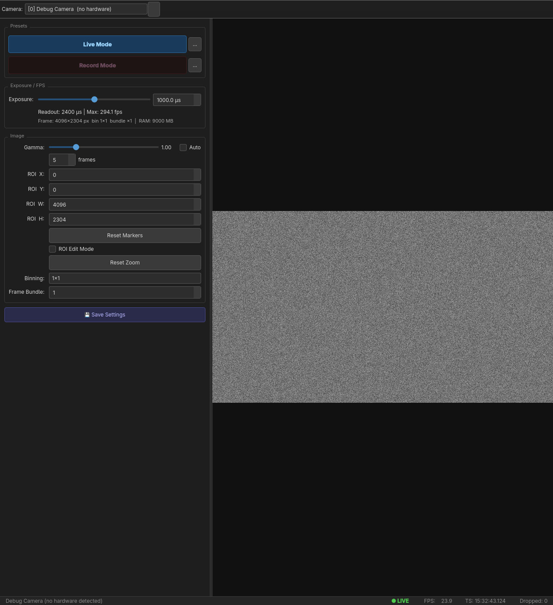
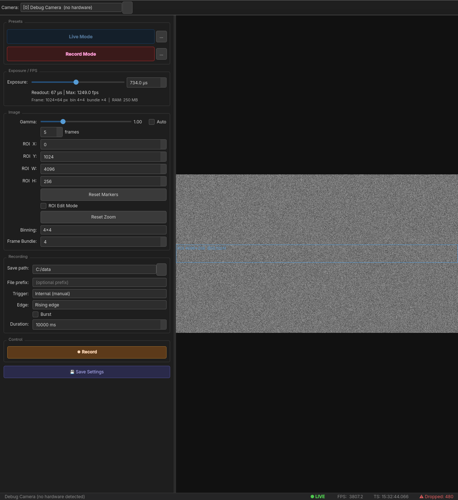
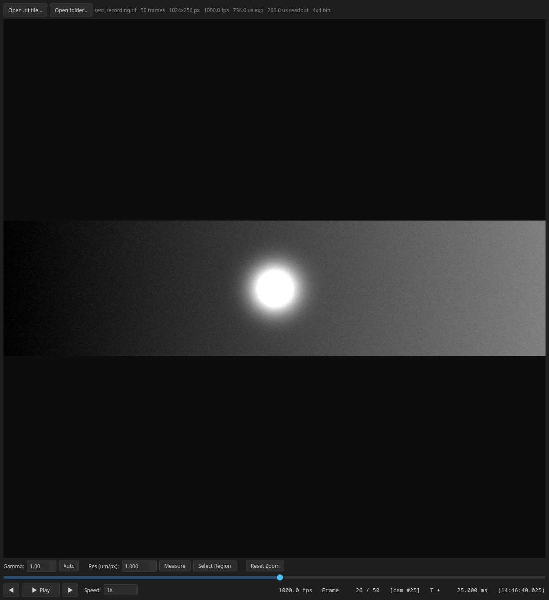

# OrcaView

Desktop application for live preview and high-speed recording from the Hamamatsu ORCA-Quest qCMOS camera via CoaXPress.



---

## Getting Started

### Requirements

- **Camera:** Hamamatsu C15550-20UP (ORCA-Quest) with CoaXPress Quad CXP-6 frame grabber
- **OS:** Windows 10/11 (64-bit)
- **RAM:** 16 GB+ recommended
- **Storage:** NVMe SSD for recording at 1000+ fps (~2 GB/s sustained write)

### Installation

1. Install [DCAM-SDK4](https://dcam-api.com/dcam-sdk-login-2/) (places `dcamapi.dll` on the system PATH)
2. Install your CoaXPress frame grabber driver (Active Silicon, Euresys, or BitFlow)
3. Connect all four CXP-6 cables
4. Verify the camera works in HoKaWo (bundled with DCAM-SDK4)

```bash
pip install PyQt6 numpy tifffile
python main.py
```

On launch, the app connects to the camera and starts live preview automatically. If no camera is found, a debug camera is used.

---

## Live Mode

When the app starts, it loads the **Live Mode** preset and begins streaming from the full sensor (4096 x 2304). Use this for alignment, focusing, and sample positioning.


The left panel shows all camera controls. The live view fills the rest of the window and scales to fit while preserving the aspect ratio.

### Navigation

- **Scroll wheel** — zoom in/out (cursor-centered)
- **Middle-click drag** — pan the view
- **Reset Zoom** button — fit image back to window

### Display Controls

- **Gamma slider** — software display gamma (does not affect recorded data). Values below 1.0 brighten shadows, above 1.0 compresses highlights.
- **Auto checkbox** — continuously auto-adjusts display contrast using frame percentiles. The interval spinbox controls how often it recalculates.

### Cell Markers

With **ROI Edit Mode** unchecked, clicking on the live view places a circular marker. Click-drag to set the marker size. Right-click a marker to remove it. Use **Reset Markers** to clear all.

---

## Record Mode

Click **Record Mode** to load the recording preset. The ROI shrinks (default: 4096 x 256, centered vertically), and the Recording controls appear.



The blue overlay on the live view shows the active ROI region. A frozen background from live mode provides spatial context so you can see where on the sensor the ROI sits.

### Setting Up a Recording

1. **Exposure slider** — set exposure time in microseconds (logarithmic scale). The readout info line shows the resulting max FPS.
2. **ROI fields** — adjust X, Y, W, H to define the sensor region. Smaller height = higher frame rate.
3. **Frame Bundle** — groups multiple frames per DMA transfer. Use 2+ for 1000+ fps throughput.
4. **Binning** — 1x1, 2x2, or 4x4 pixel binning. Always set before changing ROI.
5. **Save path** — folder where recordings are written. Click **...** to browse.
6. **File prefix** — optional prefix prepended to the filename (default: `recording_YYYYMMDD_HHMMSS`).
7. **Duration** — recording length in milliseconds. 0 = run until Stop is pressed.

### ROI Editing

Check **ROI Edit Mode** to drag-edit the ROI rectangle directly on the live view. You can move the rectangle or resize it from edges and corners. The ROI spinboxes update in real time as you drag. On release, the camera restarts with the new region.

### Starting a Recording


Click **Record** (or **Arm** for external trigger) to begin. The status bar switches to **RECORDING**. Frames stream into a RAM ring buffer while the writer thread drains it to disk in parallel. The live view continues updating at ~60 Hz during recording.

Recording stops automatically when the duration is reached, or click **Stop Rec** to end early.

### Trigger Modes

| Mode | How it works |
|---|---|
| **Internal** | Recording starts immediately when you click Record. |
| **External start trigger** | Camera waits for a TTL pulse, then free-runs until stopped. Choose rising or falling edge polarity. |

### Burst Mode

With external trigger selected, enable **Burst** to auto re-arm after each recording completes. Recordings are saved as numbered files in a session subfolder. The burst counter shows how many recordings have been saved. Click **Stop Burst** to end the sequence.

---

## Output Format

Recordings are saved as **BigTIFF** files (lossless, uncompressed, >4 GB capable):

```
recording_20261102_153000.tif
```

Each TIFF page contains one sub-frame as uint16 pixels. Page 0's `ImageDescription` tag holds full session metadata as JSON:

```json
{
  "requested": {
    "roi": {"x": 0, "y": 1024, "width": 4096, "height": 256},
    "exposure_us": 734.0,
    "binning": 4,
    "frame_bundle": 4,
    "trigger_source": 1,
    "trigger_mode": 1,
    "trigger_delay": 0.0
  },
  "actual": {
    "fps": 1080.0,
    "exposure_us": 734.0,
    "readout_us": 266.0,
    "binning": 4,
    "frame_bundle": 4,
    "image_height": 64,
    "image_width": 1024
  },
  "date": "2026-11-02T15:30:00.123456",
  "dtype": "uint16"
}
```

Every page also carries per-frame `timestamp`, `frame_index`, and `frame_number` in its `ImageDescription`.

### Loading in Python

```python
import tifffile
import json

tif = tifffile.TiffFile("recording_20261102_153000.tif")

# Session metadata from page 0
meta = json.loads(tif.pages[0].description)
print(meta["actual"]["fps"])

# Read a specific frame
frame = tif.pages[42].asarray()   # uint16, shape (H, W)

# Read all frames at once (if they fit in RAM)
stack = tif.asarray()  # shape (N, H, W)
```

---

## Recording Viewer

A standalone viewer application for playing back BigTIFF recordings:

```bash
python viewer.py                         # open GUI, then load a file
python viewer.py recording_20261102.tif  # open a file directly
```



### Playback Controls

- **Open .tif file** / **Open folder** — load a single recording or browse a folder of recordings
- **Prev/Next File** — step through files in a folder
- **Play/Pause** — play back at the recording's native frame rate
- **Speed** — from 0.001x to 50x playback speed
- **Frame slider** — scrub to any frame
- **Arrow buttons** — step one frame forward/back

### Display

- **Gamma** — display gamma correction
- **Auto** — auto-contrast (1st-99th percentile of the current frame)
- **Reset Zoom** — fit image to window (scroll to zoom, right-drag to pan)

### Measurement Tool

Click **Measure**, then click two points on the image. The distance is shown in micrometers based on the **Res (um/px)** pixel size setting.

### Region Activity Plot

Click **Select Region**, then drag a rectangle on the image. The viewer reads every frame's ROI and plots mean intensity vs. time. Use **Save Plot** to export as PNG/SVG/PDF.

### Mean Image

When a folder is open, click **Generate Mean Image** to compute the average of frame 0 across all recordings. Useful for background estimation.

---

## Presets and Config Files

Presets are plain JSON files in the `config/` folder:

| File | Purpose |
|---|---|
| `default_live_mode.json` | Full sensor, high exposure, no frame bundle |
| `default_record_mode.json` | 256-row ROI centered, 4x4 binning, frame bundle 4 |

These default presets cannot be overwritten from the GUI. Use **Save Settings** to create your own preset files with a custom name.

The **...** buttons next to Live Mode / Record Mode let you load any JSON preset file.

### Config Fields

```json
{
  "exposure_us": 734.0,
  "roi_x": 0,
  "roi_y": 1024,
  "roi_width": 4096,
  "roi_height": 256,
  "binning": 4,
  "frame_bundle": 4,
  "save_path": "C:/data",
  "file_prefix": "",
  "trigger_source": 1,
  "trigger_mode": 1,
  "trigger_polarity": 2,
  "trigger_delay": 0.0,
  "record_duration_ms": 10000,
  "burst_mode": false
}
```

| Field | Values |
|---|---|
| `exposure_us` | Sensor integration time in microseconds |
| `roi_x`, `roi_y` | Top-left corner in sensor pixels (multiples of 4) |
| `roi_width`, `roi_height` | ROI dimensions in sensor pixels (multiples of 4) |
| `binning` | 1, 2, or 4 |
| `frame_bundle` | 1 = off, 2+ for high-speed throughput |
| `trigger_source` | 1 = internal, 2 = external |
| `trigger_mode` | 1 = normal (per-frame), 6 = start (sequence) |
| `trigger_polarity` | 1 = falling edge, 2 = rising edge |
| `trigger_delay` | Seconds; 0 for normal operation |
| `record_duration_ms` | Recording length; 0 = manual stop |
| `burst_mode` | Auto re-arm after each external trigger recording |

---

## ROI and Frame Rate

Fewer sensor rows = faster readout = higher frame rate:

| ROI Height | Approx. Max FPS |
|---|---|
| 2304 (full) | ~120 fps |
| 512 rows | ~540 fps |
| 256 rows | ~1080 fps |
| 256 rows + frame bundle | 19,000+ fps |

The readout info line below the exposure slider always shows the actual max FPS for your current settings.

---

## Status Bar

| Indicator | Meaning |
|---|---|
| **IDLE / LIVE / RECORDING / ARMED** | Current camera state |
| **FPS** | Measured frame rate (rolling average) |
| **TS** | Hardware timestamp of the last displayed frame |
| **Dropped** | Frames lost in the DMA ring buffer (should be 0) |

---

## Troubleshooting

| Symptom | Fix |
|---|---|
| "Could not load dcamapi.dll" | Install DCAM-SDK4 |
| "No DCAM-compatible cameras detected" | Install frame grabber driver; check all 4 CXP cables |
| Dropped frames during recording | Use NVMe SSD; reduce ROI or duration |
| Actual FPS lower than expected | Decrease exposure; check frame bundle is valid |
| Black live view | Check ROI is within sensor bounds (X+W <= 4096, Y+H <= 2304) |
| Debug camera on startup | No hardware detected; verify camera in HoKaWo first |

---

## Project Structure

```
OrcaView/
├── main.py                      # Entry point
├── viewer.py                    # Standalone recording viewer
├── requirements.txt
├── config/
│   ├── default_live_mode.json   # Live preset (protected)
│   └── default_record_mode.json # Record preset (protected)
├── dcam/
│   ├── dcam_types.py            # ctypes structs and DCAM constants
│   ├── dcam_api.py              # dcamapi.dll loader
│   ├── camera.py                # DCAMCamera hardware driver
│   └── debug_camera.py          # Simulated camera for testing without hardware
├── core/
│   ├── settings.py              # CameraSettings dataclass + JSON I/O
│   ├── fps_calculator.py        # Rolling FPS measurement
│   ├── ring_buffer.py           # Pre-allocated numpy ring buffer
│   ├── acquisition_thread.py    # QThread: camera -> ring buffer
│   └── writer_thread.py         # QThread: ring buffer -> BigTIFF
└── gui/
    ├── styles.py                # Dark theme
    ├── status_bar.py            # Status bar widget
    ├── roi_overlay.py           # Blue ROI rectangle overlay
    ├── roi_interaction.py       # ROI drag/resize interaction
    ├── cell_markers.py          # Circular cell marker overlay
    ├── live_view.py             # Frame display with zoom/pan
    ├── control_panel.py         # Left settings panel
    └── main_window.py           # Root window, thread wiring
```
